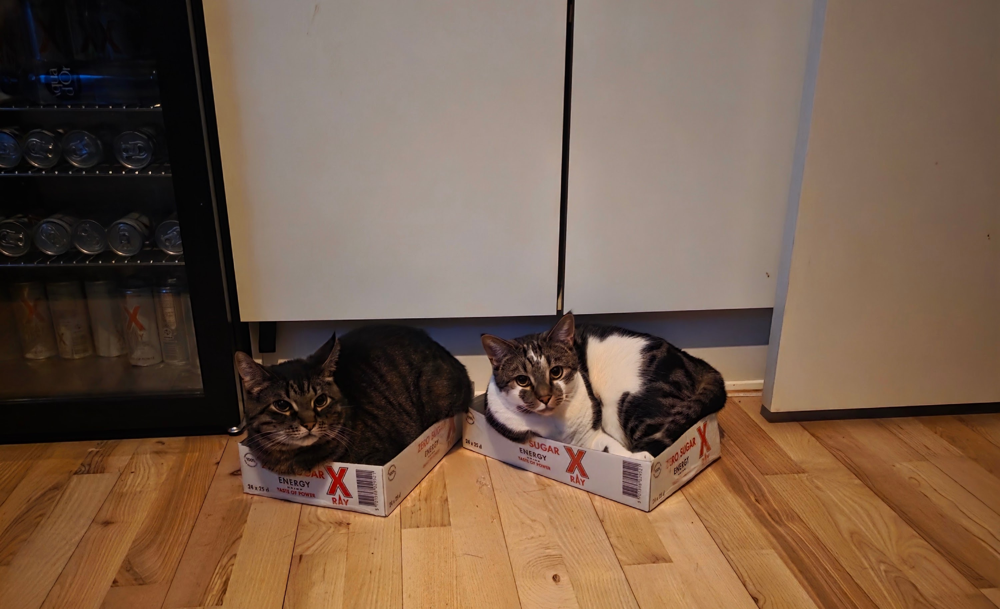
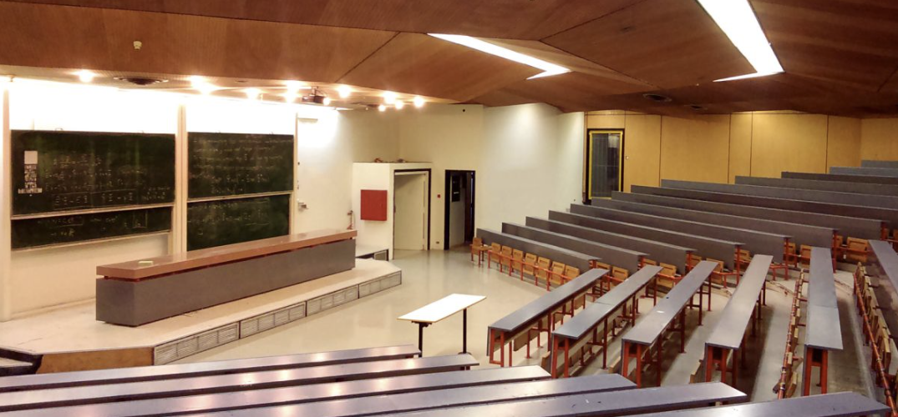
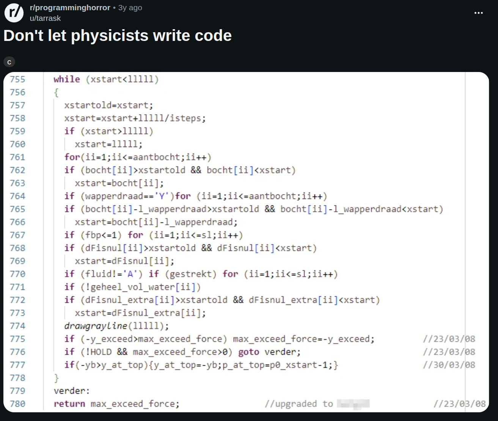
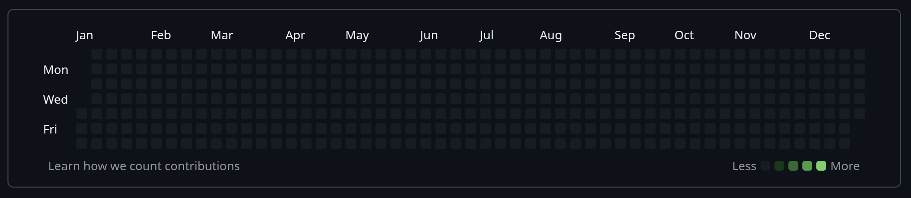

## Personal Interests
In my personal life, I am a geek (gosh I hate this word). I love computers and I am very happy to have a job that can pay for a good one (before the ram craze). I spend a lot of my free time playing video games and have done so since I was very young. I am involved in many online communities and discord servers and generally enjoy playing games with others. 

I also have a love for cats, of which my partner and I have 2. They are lovely and fuzzy and enjoy sitting on our keyboards at the worst times.

  

## The story around the CV

### Greece
My name is very common in Greece, where I'm from, but a tad unique and quirky for everyone else. So most people now know me as Vikki. I was born in Greece and spent pretty much my entire life there until I was 23. I've had my ups and downs with education, but I'd say most of my life has been spent studying. From a very young age I loved logic, rules and puzzles, so I naturally gravitated towards math, physics and programming. When it was time to pick a university, I of course chose physics (**Applied Mathematical and Physical Sciences, NTUA, Greece**)! 

    

My reasoning was simple: if I can do physics, I can *obviously* do math, and I can *definitely* figure out programming. I wish someone had warned me how notorious physicists are, both for terrible code and for being very loose with our math. I mean, we are even loose with our physics /cite{spherical_cows_in_vacuum}. I have since successfully grown into that stereotype.

  
  

University was not an easy time for me. By the time I finished my integrated master's I had come to resent academia in general. I remember telling my very patient and kind thesis supervisor that I wanted to do anything that would get me into a company, so I could get the hell out of there. And so we did. Even though I'd spent years studying particle physics, I wrote my thesis on machine learning for marketing data. Was it groundbreaking research worth showing off? Definitely not. But I figured it was enough to get me an interview somewhere, and that was all I cared about.

### Denmark
As with many big plans, though, life had other ideas. I met my partner (now of 6 years) online and moved to Denmark to be with him, in Thisted, a quiet town of 13,000 people. 

    

Guess what the Thisted job market does not need: **a particle physicist who claims to be a programmer**. And yes, I had my GitHub linked in my applications:

Despite my academic burnout, going back to university felt like the only reasonable thing to do...

In 2023 we moved to Aalborg and I joined the MSc program in **AI, Vision and Sound at Aalborg University**, hoping to build on the ML I'd picked up during my thesis and get more hands-on experience. Honestly, I was aiming for computer science, but I got rejected. Looking back, that was probably the best thing that could have happened. AVS was super practical, and it made me realize that what I'd actually resented about university was how theoretical everything was. Here I was solving real problems for once. I also got a job at **TeeJet Technologies** doing computer vision for quality inspection and getting even more experience (and money). It was great!

Around the end of my first year in AVS, while I was panicking about whether I could find an internship without moving again, a **PhD** opportunity came up. **"Underwater Computer Vision for Environmental Monitoring"** was a pretty vague title, and I had no particular background in marine life. What I did have however, was a lot of experience with physics and scattering; And so I applied with a project description focused on light scattering and image degradations. You probably already know this is what I am working on, so yeah... I got the job! And that brings us to today: As I'm writing this, I'm a bit over 2 years into my PhD and having a blast: traveling constantly, meeting amazing people, and learning something new every day. Maybe academia isn't that bad...

